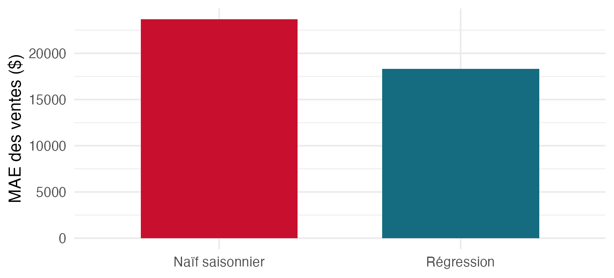
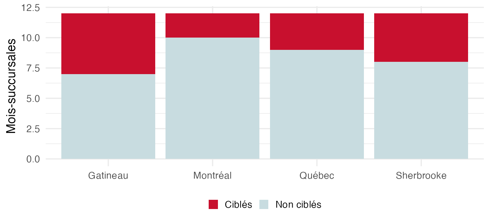

## Pourquoi ça compte

::: {.question-line}
Quelle décision les données peuvent-elles soutenir?
:::

::: {.note-box}
Une analyse utile relie une question, une preuve, une décision et une limite.
:::

## Objectifs du laboratoire

::: {.keypoints}
- Choisir une cible continue ou binaire et une référence adaptée.
- Respecter les dates et la disponibilité des informations.
- Communiquer les résultats et une règle de suivi.
:::

## Une direction, deux questions

:::: {.metric-grid}
::: {.metric}
::: {.value}
Voie A
:::
::: {.label}
Prévoir les ventes en dollars
:::
:::
::: {.metric}
::: {.value}
Voie B
:::
::: {.label}
Repérer le service insuffisant
:::
:::
::: {.metric}
::: {.value}
Un rapport
:::
::: {.label}
Une voie principale, l’autre résumée
:::
:::
::::

## Observer sans fuir le futur

::: {.keypoints}
- Une ligne représente un mois et une succursale fictive.
- Pour les ventes, le calendrier est connu; la promotion future peut être incertaine.
- Pour le service, la décision utilise les conditions du mois courant.
:::

## La chronologie change la preuve

::: {.warning-box}
Les données de 2025 ont déjà été examinées dans les modules 09 et 10. Leur réutilisation ne produit pas un nouveau test indépendant.
:::

## Voie A : même origine et mêmes cibles

::: {.keypoints}
- Origine : fin 2024; cibles : les douze mois de 2025.
- Régression avec tendance, mois et succursale.
- Référence : mêmes mois et succursales de 2024.
:::

## Voie A : lire la comparaison

{fig-alt="Erreur absolue moyenne pour les ventes, par méthode" width="82%"}

La validation est réutilisée; les mesures sont en dollars.

## Voie B : fixer la règle avant 2025

::: {.keypoints}
- Ajuster jusqu’en novembre 2023.
- Utiliser les scores de janvier à novembre 2024 pour un seuil au 80e percentile.
- Évaluer les erreurs et la proportion ciblée en 2025.
:::

## Voie B : lire la répartition

{fig-alt="Nombre d’interventions et d’observations par succursale dans la validation réutilisée" width="82%"}

La répartition appelle une vérification de contexte et d’effectifs.

## Un seuil n’est pas une capacité garantie

::: {.warning-box}
Un seuil calibré sur les scores de 2024 ne garantit pas 20 % d’interventions en 2025. Une capacité stricte exige une règle adaptée au moment des décisions.
:::

## À retenir

::: {.keypoints}
- Cible continue et cible binaire appellent des mesures différentes.
- Une référence et des données comparables donnent une preuve utile.
- Un risque prédit ne mesure pas l’effet d’une intervention.
:::

## Production du laboratoire

::: {.lead}
Dans un seul rapport Quarto, définissez la décision et la cible, vérifiez les données, développez une voie avec une référence et des mesures adaptées, puis formulez une recommandation avec une limite et un suivi. Résumez l’autre voie en trois phrases.
:::

Cette production se réalise une seule fois dans le rapport choisi.

### Auto-vérification

::: {.self-check}
- Je précise la cible, l’origine, l’horizon et l’unité.
- Je compare la méthode et sa référence sur les mêmes observations.
- Je distingue la validation réutilisée d’un nouveau test indépendant.
- Ma recommandation cite les résultats, une limite et une règle de suivi.
:::

## Rétroaction et suite

::: {.keypoints}
- Demandez une relecture de votre synthèse et corrigez un point précis.
- Vérifiez le rendu et la déclaration IA, si applicable.
- Reprenez l’autre voie ou le transfert pour la révision finale.
:::

## Références et crédits

Hyndman et Athanasopoulos (2021), *Forecasting: Principles and Practice*, 3e édition.

James, Witten, Hastie et Tibshirani (2021), *An Introduction to Statistical Learning*, 2e édition.

Données fictives du cours MQT-2101, Université Laval.
