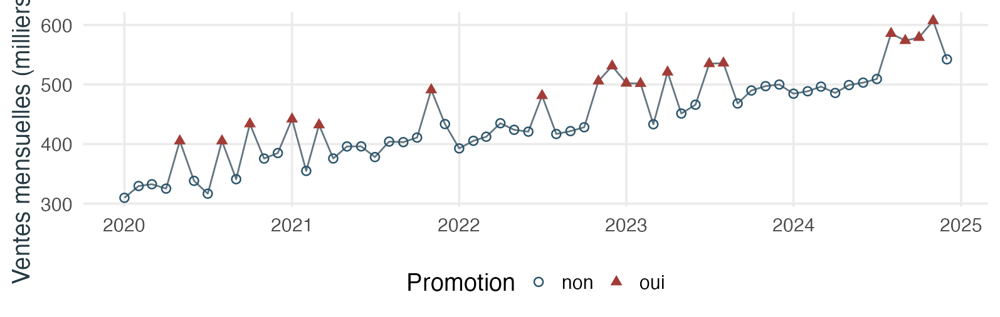

## Pourquoi ça compte

::: {.question-line}
Qu’est-ce qui est connu à l’origine?
:::

::: {.note-box}
Une direction doit prévoir avant de connaître les ventes et l’indice économique du mois à venir.
:::

## Objectifs de la capsule

::: {.keypoints}
- Classer les variables selon leur disponibilité à l’origine.
- Distinguer information connue, prévision et scénario.
- Repérer une information future qui créerait une fuite.
:::

## Fermer le dossier au 31 décembre 2024

{width="85%" fig-alt="Les 60 ventes mensuelles fictives jusqu’en décembre 2024. Les triangles indiquent les mois de promotion. Janvier 2025 est hors du tracé."}

::: {.note-box}
Nous sommes au bout de la courbe. Quelle vente faudra-t-il inscrire au point suivant ?
:::

## Une ligne de données a deux dates

| Ligne du CSV | Prix moyen | Indice | Ventes |
|---|---|---|---|
| Décembre 2024 | 61,25 $ | 111,8 | 542 217 $ |
| Janvier 2025 | 61,59 $ | 111,1 | 526 715 $ |

::: {.note-box}
La date de la ligne situe les ventes. Le fichier ne dit pas quand le prix moyen ou l’indice a été communiqué.
:::

## Qu’écririez-vous avant janvier ?

| Entrée | Statut possible | Pièce à chercher |
|---|---|---|
| Mois de janvier | Connu | Calendrier |
| Promotion | Connue si approuvée | Plan de campagne daté |
| Prix moyen | Planifié ou supposé | Tarif prévu et hypothèse sur les ventes |
| Indice de confiance | Prévu ou posé en scénario | Prévision datée ou hypothèse explicite |

::: {.note-box}
La colonne « ventes » reste vide à l’origine. On la remplira lorsque le mois sera terminé.
:::

## Le piège du prix moyen

::: {.example-box}
Un tarif de 60 $ est annoncé pour janvier. Après le mois, le prix moyen réalisé vaut 61,59 $. Peut-on inscrire 61,59 $ dans la prévision préparée en décembre ?
:::

::: {.note-box}
Le tarif annoncé peut étayer un scénario à 60 $. Le prix moyen dépend aussi des articles effectivement vendus.
:::

## Choisir une valeur pour l’indice

:::: {.concept-grid}
::: {.concept-card}
::: {.tag}
Prévision disponible
:::
::: {.text}
Si une prévision datée existe, consigner sa valeur, sa source et sa date de diffusion.
:::
:::
::: {.concept-card}
::: {.tag}
Scénario de travail
:::
::: {.text}
À défaut, écrire par exemple « indice supposé égal à 100 ». Refaire le calcul sous une autre hypothèse pour juger la sensibilité.
:::
:::
::::

## Un même modèle, deux questions

:::: {.concept-grid}
::: {.concept-card}
::: {.tag}
À la date de décision
:::
::: {.text}
Quel montant le modèle donne-t-il avec le prix et l’indice retenus fin décembre ?
:::
:::
::: {.concept-card}
::: {.tag}
Après la clôture
:::
::: {.text}
Que donne ce même modèle si on lui fournit le prix de 61,59 $ et l’indice de 111,1 réalisés en janvier ?
:::
:::
::::

## Et si la décision visait février ?

| Origine de la décision | Mois visé | Vente du mois précédent nécessaire |
|---|---|---|
| 31 décembre | Janvier | Décembre, si sa clôture est disponible |
| 31 décembre | Février | Janvier, encore à prévoir |
| 31 janvier | Février | Janvier, si sa clôture est disponible |

::: {.note-box}
Les deux dernières lignes visent février. En attendant la clôture de janvier, on change l’information et l’horizon de la prévision.
:::

## À retenir

:::: {.metric-grid}
::: {.metric}
::: {.value}
Origine
:::
::: {.label}
fin décembre 2024 : information disponible à cette date
:::
:::
::: {.metric}
::: {.value}
Disponibilité
:::
::: {.label}
valeur connue, prévue ou scénarisée
:::
:::
::: {.metric}
::: {.value}
Fuite
:::
::: {.label}
une valeur future observée après coup ne peut être connue d’avance
:::
:::
::::

## Production autonome 9.1

::: {.lead}
Classez la promotion, le prix, l’indice de confiance et les ventes futures selon leur disponibilité à la fin de 2024. Indiquez pour chacun une source connue, un scénario ou une information indisponible.
:::

Cette production se réalise une seule fois dans le rapport guidé.

### Auto-vérification

::: {.self-check}
- Je précise l’origine.
- Je distingue une valeur prévue d’une valeur observée après coup.
- Je ne mets pas la cible future parmi les prédicteurs.
:::

## Références et crédits

Matériel du cours MQT-2101, Université Laval. Données fictives simulées pour l’enseignement.

Hyndman et Athanasopoulos (2021), *Forecasting: Principles and Practice*, 3e édition.
