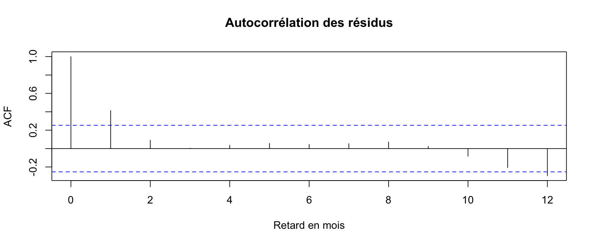

## Pourquoi ça compte

::: {.question-line}
Les erreurs se suivent-elles?
:::

::: {.note-box}
La qualité d’une prévision dépend du modèle et de l’information disponible.
:::

## Objectifs de la capsule

::: {.keypoints}
- Diagnostiquer dans le temps.
- Relier le résultat au cas guidé.
- Nommer une limite de l’interprétation.
:::

## Le raisonnement

::: {.keypoints}
- Résidu : observation moins valeur ajustée.
- Le retard 1 compare deux mois voisins; le retard 12 compare deux mois à un an d’intervalle.
- Regarder les résidus dans le temps et leur ACF.
- Le test de Ljung-Box est un complément facultatif.
:::

## ACF des résidus sur 2020 à 2024

{fig-alt="Autocorrélations des résidus de la régression aux retards de 0 à 12 mois" width="85%"}

## À retenir

:::: {.metric-grid}
::: {.metric}
::: {.value}
Incertitude
:::
::: {.label}
Une ACF peu marquée ne prouve pas l’indépendance.
:::
:::
::: {.metric}
::: {.value}
Résidus
:::
::: {.label}
Une ACF des ventes brutes n’est pas celle des résidus.
:::
:::
::::

## Production autonome 9.3

::: {.lead}
Tracez les résidus de la régression en fonction du temps et leur autocorrélation. Décrivez les motifs observés et expliquez pourquoi ils ne prouvent pas à eux seuls l’indépendance des résidus.
:::

Cette production se réalise une seule fois dans le rapport guidé.

### Auto-vérification

::: {.self-check}
- Je garde l’ordre des mois et distingue résidus et erreurs de prévision.
- Je décris les retards et les motifs visibles.
- Une ACF peu marquée ne prouve pas l’indépendance.
:::

## Références et crédits

Matériel du cours MQT-2101, Université Laval. Données fictives simulées pour l’enseignement.

Hyndman et Athanasopoulos (2021), *Forecasting: Principles and Practice*, 3e édition.
