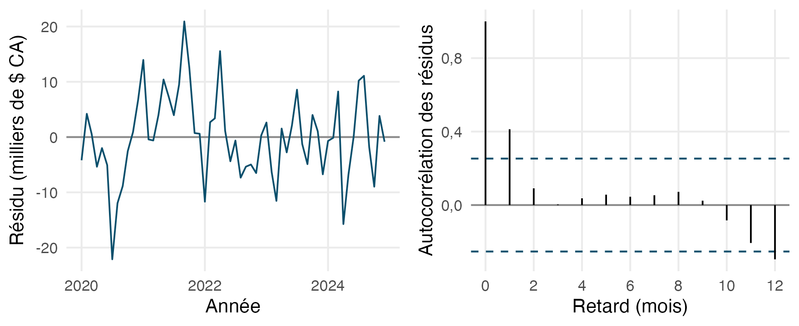

## Pourquoi ça compte

::: {.question-line}
Les erreurs successives sont-elles liées?
:::

::: {.note-box}
Des erreurs qui se suivent peuvent révéler une structure que les prédicteurs n’expliquent pas.
:::

## Objectifs de la capsule

::: {.keypoints}
- Distinguer résidu et erreur de prévision.
- Lire la fonction d’autocorrélation des résidus.
- Expliquer les limites du diagnostic.
:::

## Deux écarts, deux moments

:::: {.concept-grid}
::: {.concept-card}
::: {.tag}
Sur les mois d’entraînement
:::
::: {.text}
Résidu = vente observée moins vente ajustée. Le mois étudié a servi à estimer les coefficients.
:::
:::
::: {.concept-card}
::: {.tag}
Sur un mois tenu à part
:::
::: {.text}
Erreur de prévision = vente observée moins prévision produite avec le modèle déjà ajusté.
:::
:::
::::

## Calculer un résidu avant de lire le graphique

::: {.example-box}
En juillet 2020, les ventes atteignent 316 643 $. Le modèle ajuste environ 338 760 $. Le résidu vaut donc environ −22 117 $.
:::

::: {.note-box}
Le point est sous zéro. La vente observée est inférieure à la valeur ajustée. Quel signe attendriez-vous si le modèle sous-estimait les ventes ?
:::

## Suivre une séquence de mois

| 2020 | Mai | Juin | Juillet | Août |
|---|---|---|---|---|
| Résidu arrondi | −1 992 $ | −5 073 $ | −22 117 $ | −11 969 $ |

::: {.note-box}
Durant ces quatre mois, le modèle surestime à chaque fois. Pour savoir si cette persistance se répète, il faut examiner les 60 résidus.
:::

## Fabriquer les paires d’un retard

:::: {.concept-grid}
::: {.concept-card}
::: {.tag}
Retard 1
:::
::: {.text}
Janvier avec février, février avec mars, et ainsi de suite. Les 60 mois fournissent 59 paires voisines.
:::
:::
::: {.concept-card}
::: {.tag}
Retard 12
:::
::: {.text}
Janvier 2020 avec janvier 2021, puis février avec février. Il reste 48 paires séparées d’une année.
:::
:::
::::

## Demander les autocorrélations à R

```r
r <- residuals(modele_lm)
a <- acf(r, lag.max = 12, plot = FALSE)
data.frame(retard = as.numeric(a$lag),
           acf = round(as.numeric(a$acf), 2))
```

::: {.note-box}
La première ligne correspond au retard 0. Sa valeur de 1 vient de la comparaison de la série avec elle-même.
:::

## Autocorrélation des résidus de 2020 à 2024

{fig-alt="Résidus mensuels en milliers de dollars, puis ACF. Au retard 1, l’autocorrélation vaut 0,41. Au retard 12, elle vaut −0,30." width="85%"}

::: {.note-box}
Les pointillés sont des repères approximatifs, pas une preuve d’indépendance.
:::

## Lire deux barres de signes opposés

:::: {.concept-grid}
::: {.concept-card}
::: {.tag}
Au retard 1 : +0,41
:::
::: {.text}
Des écarts de même sens tendent à se suivre. Le tracé temporel permet de localiser les mois en cause.
:::
:::
::: {.concept-card}
::: {.tag}
Au retard 12 : −0,30
:::
::: {.text}
Les écarts à un an de distance tendent à être de sens opposés. Une explication saisonnière demanderait d’autres éléments.
:::
:::
::::

## Du diagnostic à une comparaison

::: {.example-box}
Les repères individuels valent environ ±1,96 / √60, soit ±0,25. Deux barres les franchissent. Que proposez-vous d’essayer ?
:::

::: {.note-box}
Tester un modèle où l’écart d’un mois dépend de celui du mois précédent, puis comparer ses prévisions. Le graphique seul ne désigne pas le meilleur modèle.
:::

## À retenir

:::: {.metric-grid}
::: {.metric}
::: {.value}
Résidus
:::
::: {.label}
écarts après ajustement, distincts des erreurs de prévision
:::
:::
::: {.metric}
::: {.value}
Retards
:::
::: {.label}
comparer les résidus à un ou plusieurs mois d’intervalle
:::
:::
::: {.metric}
::: {.value}
Limite
:::
::: {.label}
une autocorrélation peu marquée ne prouve pas l’indépendance
:::
:::
::::

## Production autonome 9.3

::: {.lead}
Tracez les résidus de la régression en fonction du temps et leur autocorrélation. Décrivez les motifs observés et expliquez pourquoi ils ne prouvent pas à eux seuls l’indépendance des résidus.
:::

Cette production se réalise une seule fois dans le rapport guidé.

### Auto-vérification

::: {.self-check}
- Je garde l’ordre des mois et distingue résidus et erreurs de prévision.
- Je décris les retards et les motifs visibles.
- Je sais qu’une ACF peu marquée ne prouve pas l’indépendance.
:::

## Références et crédits

Matériel du cours MQT-2101, Université Laval. Données fictives simulées pour l’enseignement.

Hyndman et Athanasopoulos (2021), *Forecasting: Principles and Practice*, 3e édition.
