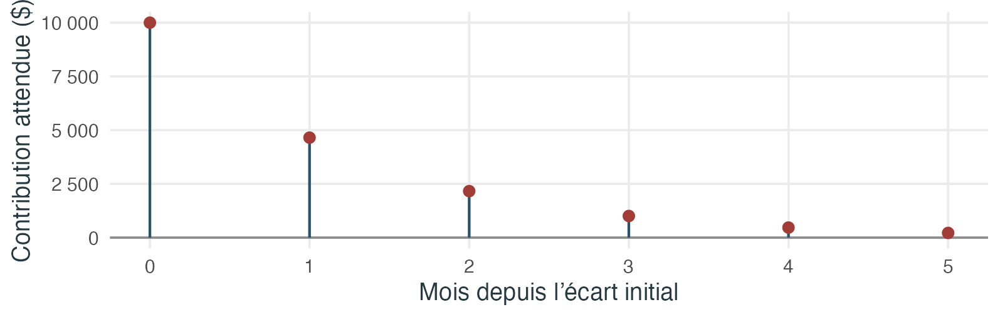

## Pourquoi ça compte

::: {.question-line}
La mémoire des erreurs améliore-t-elle la prévision?
:::

::: {.note-box}
Ajouter une dépendance temporelle ne garantit pas une meilleure prévision. La comparaison doit rester commune.
:::

## Objectifs de la capsule

::: {.keypoints}
- Comparer les deux modèles sur les mêmes mois.
- Interpréter la MAE et la RMSE en dollars.
- Nommer les limites de la comparaison conditionnelle.
:::

## Qu’est-ce qui change entre les deux modèles ?

::: {.example-box}
Ventes du mois : yt = mt + ηt Erreurs AR(1) : ηt = φ ηt−1 + εt
:::

::: {.note-box}
Les deux candidats utilisent les mêmes prédicteurs dans mt. Le second estime aussi la persistance φ. L’innovation εt est la part nouvelle du mois, après la correction apportée par le mois précédent.
:::

## Donner un sens à la persistance

{width="85%" fig-alt="Pour un écart initial hypothétique de 10 000 $, la contribution attendue descend à 4 652 $, 2 164 $ et 1 006 $ après un, deux et trois mois."}

::: {.note-box}
À chaque horizon h, la contribution vaut 10 000 × φh, avec φ ≈ 0,465. Le graphique isole cette contribution à la prévision des ventes.
:::

## Fixer les règles avant de comparer

| Élément | Règle commune |
|---|---|
| Estimation | Janvier 2020 à décembre 2024, soit 60 mois |
| Origine et horizons | Fin décembre 2024, puis de 1 à 12 mois |
| Prédicteurs futurs | Même prix, même promotion et même indice réalisés en 2025 |
| Cibles | Mêmes douze ventes mensuelles de 2025 |

::: {.note-box}
Aucun modèle n’est réajusté entre janvier et décembre. Les deux reçoivent exactement les mêmes informations.
:::

## Commencer par deux mois

| 2025 | Ventes observées | Régression ordinaire | Erreurs AR(1) |
|---|---|---|---|
| Janvier | 526 715 $ | 520 664 $ | 518 310 $ |
| Juillet | 615 840 $ | 600 840 $ | 602 557 $ |

::: {.note-box}
En janvier, les écarts absolus sont d’environ 6 051 $ et 8 405 $. En juillet, ils sont de 15 000 $ et 13 283 $. Quel modèle choisiriez-vous selon le mois regardé ?
:::

## Passer des erreurs mensuelles au score

::: {.example-box}
MAE = moyenne des |erreurs| RMSE = racine de la moyenne des erreurs²
:::

::: {.note-box}
Avec deux erreurs de +3 000 $ et −4 000 $, la MAE vaut 3 500 $. La RMSE vaut √[(3 000² + 4 000²)/2] ≈ 3 536 $. Pour le classement du cours, refaites le calcul sur les douze erreurs de chaque modèle.
:::

## Comparaison des douze mois de 2025

{fig-alt="Ventes observées et prévisions conditionnelles en 2025. Régression ordinaire : MAE de 5 088 $ et RMSE de 6 272 $. Erreurs AR(1) : MAE de 5 380 $ et RMSE de 6 417 $." width="85%"}

La ligne noire représente les ventes observées.

## Pourquoi retenir la régression ordinaire ici ?

:::: {.concept-grid}
::: {.concept-card}
::: {.tag}
Le diagnostic
:::
::: {.text}
Un retard 1 marqué justifiait d’essayer un modèle AR(1). Il renseigne sur la structure des résidus d’entraînement.
:::
:::
::: {.concept-card}
::: {.tag}
La décision sur 2025
:::
::: {.text}
La MAE passe de 5 380 $ à 5 088 $ en retenant la régression ordinaire. La RMSE la favorise aussi. C’est un bilan sur douze mois.
:::
:::
::::

## Que faudrait-il pour évaluer un déploiement réel ?

::: {.example-box}
Un collègue annonce : « En décembre 2024, on aurait prévu avec une MAE de 5 088 $. » Quels renseignements lui manquent ?
:::

::: {.note-box}
Retrouver les prix, promotions et prévisions d’indice effectivement disponibles à chaque origine. Ce bloc de 2025 a déjà servi au module 08. Une autre période permettrait une nouvelle évaluation.
:::

## À retenir

:::: {.metric-grid}
::: {.metric}
::: {.value}
Comparaison
:::
::: {.label}
mêmes mois et mêmes prédicteurs pour les deux modèles
:::
:::
::: {.metric}
::: {.value}
Information
:::
::: {.label}
valeurs externes observées en 2025 : résultats conditionnels
:::
:::
::: {.metric}
::: {.value}
Validation
:::
::: {.label}
douze mois déjà examinés, sans nouveau test indépendant
:::
:::
::::

## Production autonome 9.4

::: {.lead}
À partir de la démonstration fournie, comparez la régression ordinaire et la régression avec erreurs AR(1) sur les mêmes douze mois à l’aide de la MAE et de la RMSE. Indiquez que les prédicteurs de validation sont les valeurs effectivement observées.
:::

Cette production se réalise une seule fois dans le rapport guidé.

### Auto-vérification

::: {.self-check}
- Je compare les deux modèles sur les mêmes observations et prédicteurs.
- J’exprime les scores en dollars.
- Je présente cette comparaison comme conditionnelle aux valeurs réalisées.
:::

## Références et crédits

Matériel du cours MQT-2101, Université Laval. Données fictives simulées pour l’enseignement.

Hyndman et Athanasopoulos (2021), *Forecasting: Principles and Practice*, 3e édition.
