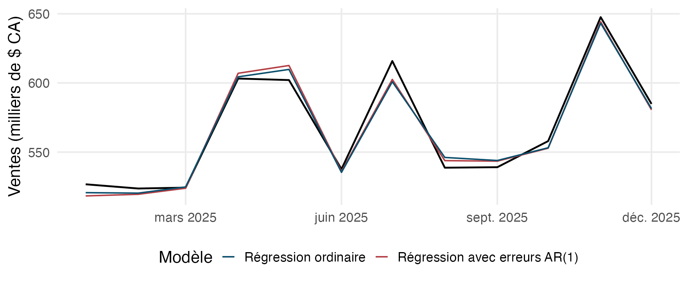

## Pourquoi ça compte

::: {.question-line}
La mémoire des erreurs améliore-t-elle la prévision?
:::

::: {.note-box}
Ajouter une dépendance temporelle ne garantit pas une meilleure prévision. La comparaison doit rester commune.
:::

## Objectifs de la capsule

::: {.keypoints}
- Comparer les deux modèles sur les mêmes mois.
- Interpréter la MAE et la RMSE en dollars.
- Nommer les limites de la comparaison conditionnelle.
:::

## Comparer sur les mêmes douze mois

::: {.keypoints}
- La régression ordinaire et la régression avec erreurs AR(1) utilisent les mêmes prédicteurs.
- Les erreurs autorégressives d’ordre 1, AR(1), relient la partie non expliquée à celle du mois précédent.
- Comparer l’erreur absolue moyenne (MAE) et la racine de l’erreur quadratique moyenne (RMSE) sur les mêmes mois.
:::

## Comparaison des douze mois de 2025

{fig-alt="Ventes observées et deux prévisions conditionnelles pendant les douze mois de 2025" width="85%"}

La ligne noire représente les ventes observées.

## À retenir

:::: {.metric-grid}
::: {.metric}
::: {.value}
Comparaison
:::
::: {.label}
mêmes mois et mêmes prédicteurs pour les deux modèles
:::
:::
::: {.metric}
::: {.value}
Information
:::
::: {.label}
valeurs externes observées en 2025 : résultats conditionnels
:::
:::
::: {.metric}
::: {.value}
Validation
:::
::: {.label}
douze mois déjà examinés, sans nouveau test indépendant
:::
:::
::::

## Production autonome 9.4

::: {.lead}
À partir de la démonstration fournie, comparez la régression ordinaire et la régression avec erreurs AR(1) sur les mêmes douze mois à l’aide de la MAE et de la RMSE. Indiquez que les prédicteurs de validation sont les valeurs effectivement observées.
:::

Cette production se réalise une seule fois dans le rapport guidé.

### Auto-vérification

::: {.self-check}
- Je compare les deux modèles sur les mêmes observations et prédicteurs.
- J’exprime les scores en dollars.
- Je présente cette comparaison comme conditionnelle aux valeurs réalisées.
:::

## Références et crédits

Matériel du cours MQT-2101, Université Laval. Données fictives simulées pour l’enseignement.

Hyndman et Athanasopoulos (2021), *Forecasting: Principles and Practice*, 3e édition.
