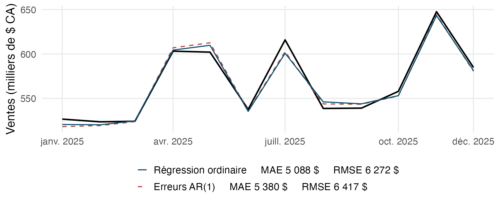

## Pourquoi ça compte

::: {.question-line}
La mémoire des erreurs améliore-t-elle la prévision?
:::

::: {.note-box}
Ajouter une dépendance temporelle ne garantit pas une meilleure prévision. La comparaison doit rester commune.
:::

## Objectifs de la capsule

::: {.keypoints}
- Comparer les deux modèles sur les mêmes mois.
- Interpréter la MAE et la RMSE en dollars.
- Nommer les limites de la comparaison conditionnelle.
:::

## Qu’est-ce qui change entre les deux modèles ?

:::: {.concept-grid}
::: {.concept-card}
::: {.tag}
La régression
:::
::: {.text}
Dans les deux cas, les ventes dépendent de la tendance, du mois, de la promotion, du prix et de l’indice.
:::
:::
::: {.concept-card}
::: {.tag}
La partie inexpliquée
:::
::: {.text}
Avec des erreurs AR(1), une partie de l’écart du mois précédent persiste. Les coefficients de la régression et cette persistance sont estimés ensemble.
:::
:::
::::

## Donner un sens à la persistance

::: {.example-box}
Le coefficient AR(1) estimé vaut 0,465. Imaginons que le dernier écart du processus d’erreur soit de +10 000 $. Sa contribution prévue un mois plus tard vaut environ +4 652 $.
:::

::: {.note-box}
À deux mois, il en reste environ 2 164 $, puis 1 006 $ à trois mois. Ces montants illustrent la propagation de l’écart initial, en supposant les innovations futures de moyenne nulle.
:::

## Fixer les règles avant de comparer

| Élément | Règle commune |
|---|---|
| Estimation | Janvier 2020 à décembre 2024, soit 60 mois |
| Origine et horizons | Fin décembre 2024, puis de 1 à 12 mois |
| Prédicteurs futurs | Même prix, même promotion et même indice réalisés en 2025 |
| Cibles | Mêmes douze ventes mensuelles de 2025 |

::: {.note-box}
Aucun modèle n’est réajusté entre janvier et décembre. Les deux reçoivent exactement les mêmes informations.
:::

## Commencer par deux mois

| 2025 | Ventes observées | Régression ordinaire | Erreurs AR(1) |
|---|---|---|---|
| Janvier | 526 715 $ | 520 664 $ | 518 310 $ |
| Juillet | 615 840 $ | 600 840 $ | 602 557 $ |

::: {.note-box}
En janvier, les écarts absolus sont d’environ 6 051 $ et 8 405 $. En juillet, ils sont de 15 000 $ et 13 283 $. Quel modèle choisiriez-vous selon le mois regardé ?
:::

## Passer des erreurs mensuelles au score

:::: {.concept-grid}
::: {.concept-card}
::: {.tag}
MAE
:::
::: {.text}
Prendre la valeur absolue de chaque erreur, additionner les douze valeurs et diviser par douze. Chaque dollar d’erreur pèse autant.
:::
:::
::: {.concept-card}
::: {.tag}
RMSE
:::
::: {.text}
Élever chaque erreur au carré, faire la moyenne, puis prendre la racine. Les grands écarts pèsent davantage. Le résultat se lit en dollars.
:::
:::
::::

## Comparaison des douze mois de 2025

{fig-alt="Ventes observées et prévisions conditionnelles en 2025. Régression ordinaire : MAE de 5 088 $ et RMSE de 6 272 $. Erreurs AR(1) : MAE de 5 380 $ et RMSE de 6 417 $." width="85%"}

La ligne noire représente les ventes observées.

## Pourquoi retenir la régression ordinaire ici ?

:::: {.concept-grid}
::: {.concept-card}
::: {.tag}
Le diagnostic
:::
::: {.text}
Un retard 1 marqué justifiait d’essayer un modèle AR(1). Il renseigne sur la structure des résidus d’entraînement.
:::
:::
::: {.concept-card}
::: {.tag}
La décision sur 2025
:::
::: {.text}
La MAE passe de 5 380 $ à 5 088 $ en retenant la régression ordinaire. La RMSE la favorise aussi. C’est un bilan sur douze mois.
:::
:::
::::

## Que faudrait-il pour évaluer un déploiement réel ?

::: {.example-box}
Un collègue annonce : « En décembre 2024, on aurait prévu avec une MAE de 5 088 $. » Quels renseignements lui manquent ?
:::

::: {.note-box}
Retrouver les prix, promotions et prévisions d’indice effectivement disponibles à chaque origine. Ce bloc de 2025 a déjà servi au module 08. Une autre période permettrait une nouvelle évaluation.
:::

## À retenir

:::: {.metric-grid}
::: {.metric}
::: {.value}
Comparaison
:::
::: {.label}
mêmes mois et mêmes prédicteurs pour les deux modèles
:::
:::
::: {.metric}
::: {.value}
Information
:::
::: {.label}
valeurs externes observées en 2025 : résultats conditionnels
:::
:::
::: {.metric}
::: {.value}
Validation
:::
::: {.label}
douze mois déjà examinés, sans nouveau test indépendant
:::
:::
::::

## Production autonome 9.4

::: {.lead}
À partir de la démonstration fournie, comparez la régression ordinaire et la régression avec erreurs AR(1) sur les mêmes douze mois à l’aide de la MAE et de la RMSE. Indiquez que les prédicteurs de validation sont les valeurs effectivement observées.
:::

Cette production se réalise une seule fois dans le rapport guidé.

### Auto-vérification

::: {.self-check}
- Je compare les deux modèles sur les mêmes observations et prédicteurs.
- J’exprime les scores en dollars.
- Je présente cette comparaison comme conditionnelle aux valeurs réalisées.
:::

## Références et crédits

Matériel du cours MQT-2101, Université Laval. Données fictives simulées pour l’enseignement.

Hyndman et Athanasopoulos (2021), *Forecasting: Principles and Practice*, 3e édition.
