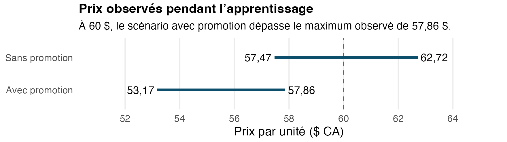

## Pourquoi ça compte

::: {.question-line}
Que dire sous deux scénarios?
:::

::: {.note-box}
Une prévision sous scénario dépend des valeurs supposées; elle ne garantit pas ce qui se produira.
:::

## Objectifs de la capsule

::: {.keypoints}
- Comparer deux scénarios pour janvier 2025.
- Expliciter leurs hypothèses communes.
- Distinguer différence prédite et effet causal.
:::

## Préparer deux fiches pour janvier

:::: {.concept-grid}
::: {.concept-card}
::: {.tag}
Entrées communes
:::
::: {.text}
Origine : fin décembre 2024. Mois : janvier. Tendance : 61. Prix : 60 $ par unité. Indice supposé : 100.
:::
:::
::: {.concept-card}
::: {.tag}
Une seule entrée change
:::
::: {.text}
Dans la première fiche, promotion vaut « non ». Dans la seconde, promotion vaut « oui ». La cible est le total des ventes de janvier, en dollars.
:::
:::
::::

## Passer les deux fiches à predict()

```r
scenario <- data.frame(
  tendance = 61, mois = factor(1, levels = 1:12),
  promotion = factor(c("non", "oui"), levels = c("non", "oui")),
  prix_moyen = 60, indice_confiance = 100
)
round(predict(modele_lm, newdata = scenario))
```

::: {.note-box}
La fonction utilise les coefficients déjà ajustés. Chaque ligne du tableau demande une prévision pour le même mois.
:::

## Janvier 2025 sous deux scénarios

:::: {.metric-grid}
::: {.metric}
::: {.value}
498 619 $
:::
::: {.label}
Sans promotion
:::
:::
::: {.metric}
::: {.value}
546 185 $
:::
::: {.label}
Avec promotion
:::
:::
::: {.metric}
::: {.value}
60 $ et 100
:::
::: {.label}
Prix par unité et indice supposés
:::
:::
::::

{.absolute left=16 top=290 width=1330 style="margin: 0; max-width: none; max-height: none;" fig-alt="Prix observés de 2020 à 2024 : de 53,17 à 57,86 $ avec promotion et de 57,47 à 62,72 $ sans promotion. À 60 $, le modèle extrapole pour la promotion."}

## Pourquoi l’écart vaut-il encore 47 566 $ ?

::: {.example-box}
546 185 $ − 498 619 $ = 47 566 $. Dans cette régression additive, les deux fiches ne diffèrent que par l’indicatrice de promotion.
:::

::: {.note-box}
Un contraste facile à calculer peut reposer sur peu d’observations comparables. Où se trouve 60 $ sur chacune des deux plages de prix ?
:::

## Essayer un prix dans la zone commune

| Prix supposé | Sans promotion | Avec promotion |
|---|---|---|
| 60,00 $ | 498 619 $ | 546 185 $ |
| 57,70 $ | 509 878 $ | 557 444 $ |

::: {.note-box}
Les deux plages de prix se recoupent de 57,47 $ à 57,86 $. À 57,70 $, on évite l’extrapolation sur le prix seul. Les profils complets peuvent rester peu représentés.
:::

## Mesurer la sensibilité à une autre hypothèse

| Indice supposé | Ventes prévues sans promotion |
|---|---|
| 100 points | 498 619 $ |
| 105 points | 512 055 $ |

::: {.note-box}
Au même prix de 60 $, cinq points d’indice de plus déplacent la prévision de 13 436 $ environ. Cet écart entre scénarios ne donne pas la probabilité de chacun.
:::

## Deux sources d’incertitude

:::: {.concept-grid}
::: {.concept-card}
::: {.tag}
Même scénario, ventes variables
:::
::: {.text}
Même avec prix, promotion et indice fixés, la vente de janvier peut s’écarter de la prévision. Un intervalle de prévision conditionnel vise cette variation sous les hypothèses du modèle.
:::
:::
::: {.concept-card}
::: {.tag}
Scénario encore incertain
:::
::: {.text}
Si le prix ou l’indice change, la prévision se déplace aussi. Comparer plusieurs scénarios rend cette sensibilité visible.
:::
:::
::::

## Que transmettre à la direction ?

::: {.example-box}
« Pour janvier, à 60 $ et avec un indice de 100, notre scénario donne environ 499 000 $ sans promotion et 546 000 $ avec promotion. »
:::

::: {.note-box}
Complétez le message : le prix de 60 $ dépasse les prix observés en promotion. L’écart décrit deux scénarios du modèle. Avant de décider, vérifier le prix réellement envisagé.
:::

## À retenir

:::: {.metric-grid}
::: {.metric}
::: {.value}
Scénarios
:::
::: {.label}
prix de 60 $ et indice de 100 points dans les deux cas
:::
:::
::: {.metric}
::: {.value}
Intervalle
:::
::: {.label}
conditionnel aux valeurs fixées des prédicteurs
:::
:::
::: {.metric}
::: {.value}
Portée
:::
::: {.label}
une différence prédite, sans effet causal démontré
:::
:::
::::

## Production autonome 9.5

::: {.lead}
Pour janvier 2025, comparez les prévisions de la régression ordinaire sous promotion oui et non, à prix et indice identiques. Présentez les hypothèses, une limite causale et l’incertitude non couverte liée aux prédicteurs futurs.
:::

Cette production se réalise une seule fois dans le rapport guidé.

### Auto-vérification

::: {.self-check}
- Je donne la cible, l’horizon et les valeurs du scénario.
- Je ne présente pas la différence comme un effet causal établi.
- Je rappelle que le scénario n’est pas nécessairement le futur réalisé.
:::

## Références et crédits

Matériel du cours MQT-2101, Université Laval. Données fictives simulées pour l’enseignement.

Hyndman et Athanasopoulos (2021), *Forecasting: Principles and Practice*, 3e édition.
