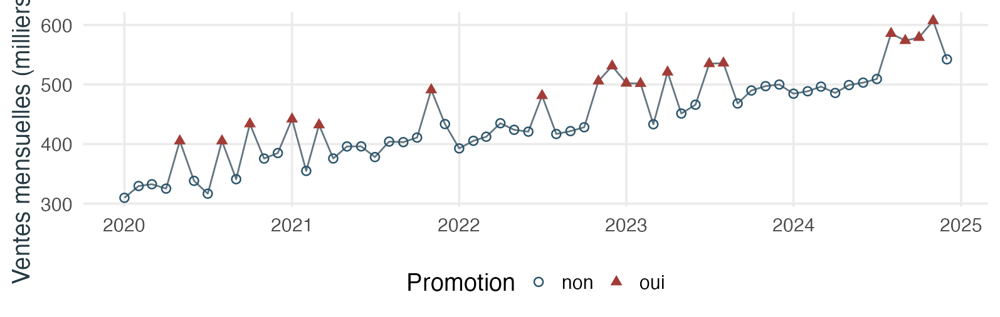
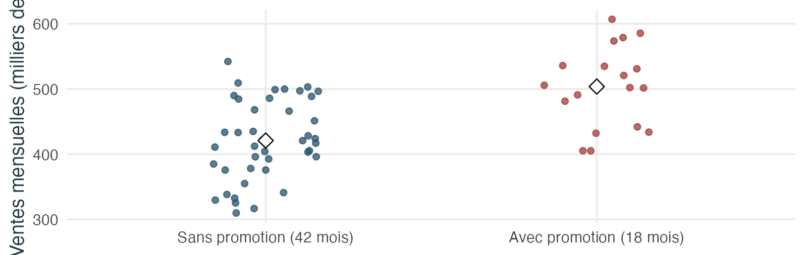
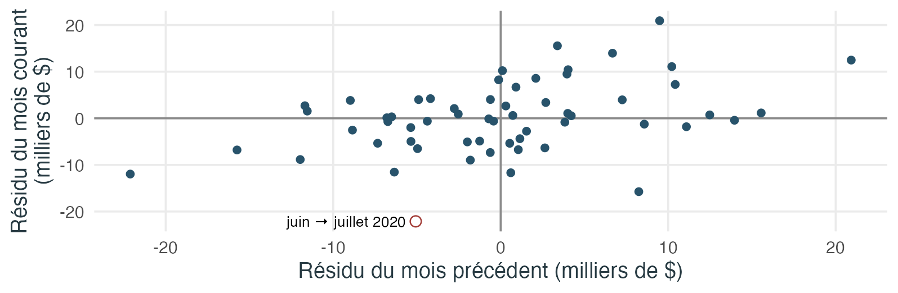
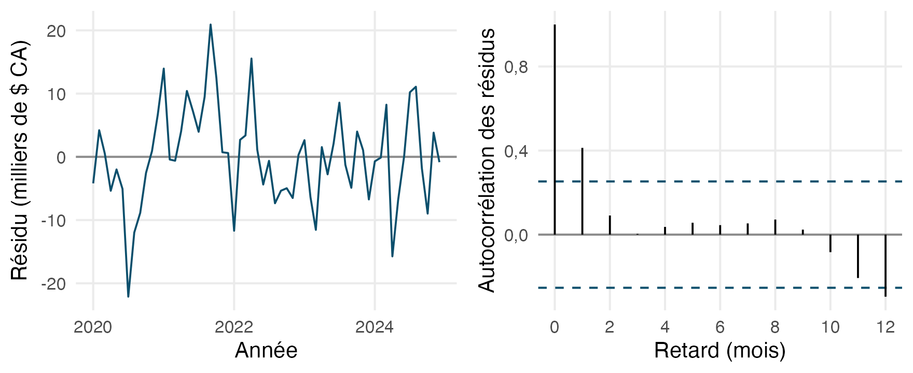
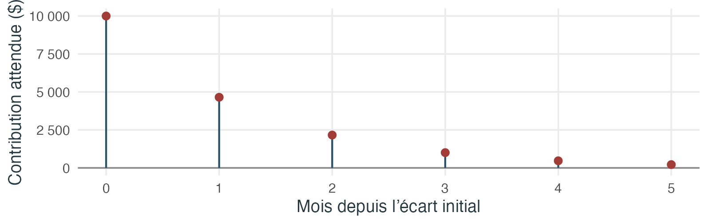
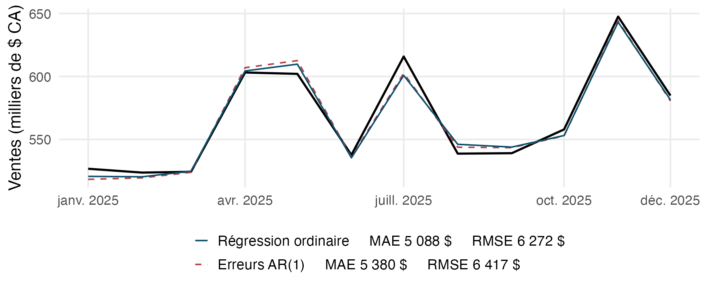
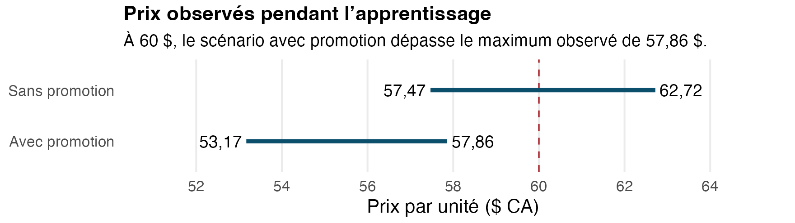

## La décision de décembre

::: {.question-line}
La direction prépare janvier. Elle veut savoir combien elle pourrait vendre avec une promotion et quelles informations il lui faudra pour utiliser ce chiffre.
:::

::: {.note-box}
Une ligne du fichier représente un mois. Les ventes sont en dollars canadiens, le prix en dollars par unité et l’indice en points. Les deux jeux du module sont fictifs.
:::

## Le parcours en cinq questions

| Avant de calculer | Après l’ajustement |
|---|---|
| Que savait-on le 31 décembre ? | Les résidus se suivent-ils ? |
| Quels mois et quels profils compare-t-on ? | Une correction AR(1) améliore-t-elle les prévisions ? |

Que peut-on finalement annoncer à la direction sur le prix et la promotion ?

## Regarder la série à son origine

{width="85%" fig-alt="Les 60 ventes mensuelles fictives jusqu’en décembre 2024. Les triangles indiquent les mois de promotion. Janvier 2025 est hors du tracé."}

::: {.note-box}
Nous sommes au bout de la courbe. Quelle vente faudra-t-il inscrire au point suivant ?
:::

## Une ligne de données a deux dates

| Ligne du CSV | Prix moyen | Indice | Ventes |
|---|---|---|---|
| Décembre 2024 | 61,25 $ | 111,8 | 542 217 $ |
| Janvier 2025 | 61,59 $ | 111,1 | 526 715 $ |

::: {.note-box}
La date de la ligne situe les ventes. Le fichier ne dit pas quand le prix moyen ou l’indice a été communiqué.
:::

## Construire une ligne de prévision

| Entrée | Statut possible | Pièce à chercher |
|---|---|---|
| Mois de janvier | Connu | Calendrier |
| Promotion | Connue si approuvée | Plan de campagne daté |
| Prix moyen | Planifié ou supposé | Tarif prévu et hypothèse sur les ventes |
| Indice de confiance | Prévu ou posé en scénario | Prévision datée ou hypothèse explicite |

::: {.note-box}
La colonne « ventes » reste vide à l’origine. On la remplira lorsque le mois sera terminé.
:::

## Et si la décision visait février ?

| Origine de la décision | Mois visé | Vente du mois précédent nécessaire |
|---|---|---|
| 31 décembre | Janvier | Décembre, si sa clôture est disponible |
| 31 décembre | Février | Janvier, encore à prévoir |
| 31 janvier | Février | Janvier, si sa clôture est disponible |

::: {.note-box}
Les deux dernières lignes visent février. En attendant la clôture de janvier, on change l’information et l’horizon de la prévision.
:::

## Une promotion coïncide avec des ventes plus élevées

{width="85%" fig-alt="Un point par mois. Les moyennes des 42 mois sans promotion et des 18 avec promotion sont marquées par des losanges."}

::: {.note-box}
Les losanges indiquent 420 892 $ sans promotion et 503 764 $ avec promotion. D’où pourraient venir les 82 872 $ d’écart ?
:::

## Écrire le modèle des ventes

::: {.example-box}
m<sub>t</sub> = constante + tendance + effet du mois<br>+ β<sub>P</sub> × promotion + β<sub>p</sub> × prix + β<sub>I</sub> × indice
:::

::: {.note-box}
La promotion vaut 0 ou 1. Janvier sert de mois de référence. Le terme du mois distingue le calendrier, celui de tendance distingue deux années au même mois. Les coefficients sont ajustés ensemble sur 60 observations.
:::

## Ajuster sur les mois disponibles

```r
modele_lm <- lm(
  ventes ~ tendance + promotion + prix_moyen +
    indice_confiance + mois,
  data = entrainement
)
coef(modele_lm)["promotionoui"]
```

::: {.note-box}
Dans le projet guidé, l’entraînement s’arrête en décembre 2024. Le facteur promotion prend « non » comme référence.
:::

## Lire trois lignes du même ajustement

| Terme | Variation considérée | Écart de ventes ajustées |
|---|---|---|
| promotionoui | Passer de non à oui | +47 566 $ |
| prix_moyen | Augmenter de 1 $ par unité | −4 895 $ |
| indice_confiance | Augmenter de 1 point | +2 687 $ |

::: {.note-box}
Lire chaque ligne en gardant fixes les autres termes du modèle. Les trois coefficients n’ont pas la même unité.
:::

## Faire apparaître le coefficient par soustraction

::: {.example-box}
Ventes ajustées sans promotion = B<br>Ventes ajustées avec promotion = B + 47 566 $
:::

::: {.note-box}
B réunit la constante, la tendance, le mois, le prix et l’indice. Pour le même profil, soustraire B laisse 47 566 $. Dans les données brutes, ces termes changent aussi d’un mois à l’autre.
:::

## Si le prix baisse en même temps

:::: {.concept-grid}
::: {.concept-card}
::: {.tag}
Hypothèse de calcul
:::
::: {.text}
Envisager à la fois une promotion et un prix inférieur de 1 $. Garder le mois, la tendance et l’indice identiques.
:::
:::
::: {.concept-card}
::: {.tag}
Calcul sous le modèle
:::
::: {.text}
La promotion ajoute 47 566 $ aux ventes ajustées. La baisse de prix ajoute 4 895 $ selon le modèle. Ensemble, l’écart prévu est d’environ 52 461 $.
:::
:::
::::

## Deux écarts, deux moments

:::: {.concept-grid}
::: {.concept-card}
::: {.tag}
Sur les mois d’entraînement
:::
::: {.text}
Résidu = vente observée moins vente ajustée. Le mois étudié a servi à estimer les coefficients.
:::
:::
::: {.concept-card}
::: {.tag}
Sur un mois tenu à part
:::
::: {.text}
Erreur de prévision = vente observée moins prévision produite avec le modèle déjà ajusté.
:::
:::
::::

## Calculer un résidu avant de lire le graphique

::: {.example-box}
Résidu = vente observée − vente ajustée<br>Juillet 2020 : 316 643 $ − 338 760 $ ≈ −22 117 $
:::

::: {.note-box}
Placez le point sous la ligne zéro. Le modèle surestime la vente de juillet. De quel côté placeriez-vous un mois où le modèle sous-estime les ventes ?
:::

## Fabriquer les paires d’un retard

{width="85%" fig-alt="59 couples de résidus consécutifs. Juin et juillet 2020 forment le point entouré, situé dans le quadrant négatif."}

::: {.note-box}
Au retard 1, juin et juillet donnent le point (−5,1 , −22,1) en milliers de dollars. Au retard 12, associez janvier 2020 à janvier 2021. Combien de paires restent-elles ?
:::

## Autocorrélation des résidus de 2020 à 2024

{fig-alt="Résidus mensuels en milliers de dollars, puis ACF. Au retard 1, l’autocorrélation vaut 0,41. Au retard 12, elle vaut −0,30." width="85%"}

::: {.note-box}
Les pointillés sont des repères approximatifs, pas une preuve d’indépendance.
:::

## Lire deux barres de signes opposés

:::: {.concept-grid}
::: {.concept-card}
::: {.tag}
Au retard 1 : +0,41
:::
::: {.text}
Des écarts de même sens tendent à se suivre. Le tracé temporel permet de localiser les mois en cause.
:::
:::
::: {.concept-card}
::: {.tag}
Au retard 12 : −0,30
:::
::: {.text}
Les écarts à un an de distance tendent à être de sens opposés. Une explication saisonnière demanderait d’autres éléments.
:::
:::
::::

## Qu’est-ce qui change entre les deux modèles ?

::: {.example-box}
Ventes du mois : y<sub>t</sub> = m<sub>t</sub> + η<sub>t</sub><br>Erreurs AR(1) : η<sub>t</sub> = φ η<sub>t−1</sub> + ε<sub>t</sub>
:::

::: {.note-box}
Les deux candidats utilisent les mêmes prédicteurs dans m<sub>t</sub>. Le second estime aussi la persistance φ. L’innovation ε<sub>t</sub> est la part nouvelle du mois, après la correction apportée par le mois précédent.
:::

## Donner un sens à la persistance

{width="85%" fig-alt="Pour un écart initial hypothétique de 10 000 $, la contribution attendue descend à 4 652 $, 2 164 $ et 1 006 $ après un, deux et trois mois."}

::: {.note-box}
À chaque horizon h, la contribution vaut 10 000 × φ<sup>h</sup>, avec φ ≈ 0,465. Le graphique isole cette contribution à la prévision des ventes.
:::

## Fixer les règles avant de comparer

| Élément | Règle commune |
|---|---|
| Estimation | Janvier 2020 à décembre 2024, soit 60 mois |
| Origine et horizons | Fin décembre 2024, puis de 1 à 12 mois |
| Prédicteurs futurs | Même prix, même promotion et même indice réalisés en 2025 |
| Cibles | Mêmes douze ventes mensuelles de 2025 |

::: {.note-box}
Aucun modèle n’est réajusté entre janvier et décembre. Les deux reçoivent exactement les mêmes informations.
:::

## Commencer par deux mois

| 2025 | Ventes observées | Régression ordinaire | Erreurs AR(1) |
|---|---|---|---|
| Janvier | 526 715 $ | 520 664 $ | 518 310 $ |
| Juillet | 615 840 $ | 600 840 $ | 602 557 $ |

::: {.note-box}
En janvier, les écarts absolus sont d’environ 6 051 $ et 8 405 $. En juillet, ils sont de 15 000 $ et 13 283 $. Quel modèle choisiriez-vous selon le mois regardé ?
:::

## Passer des erreurs mensuelles au score

::: {.example-box}
MAE = moyenne des |erreurs|<br>RMSE = racine de la moyenne des erreurs²
:::

::: {.note-box}
Avec deux erreurs de +3 000 $ et −4 000 $, la MAE vaut 3 500 $. La RMSE vaut √[(3 000² + 4 000²)/2] ≈ 3 536 $. Pour le classement du cours, refaites le calcul sur les douze erreurs de chaque modèle.
:::

## Comparaison des douze mois de 2025

{fig-alt="Ventes observées et prévisions conditionnelles en 2025. Régression ordinaire : MAE de 5 088 $ et RMSE de 6 272 $. Erreurs AR(1) : MAE de 5 380 $ et RMSE de 6 417 $." width="85%"}

La ligne noire représente les ventes observées.

## Que faudrait-il pour évaluer un déploiement réel ?

::: {.example-box}
Un collègue annonce : « En décembre 2024, on aurait prévu avec une MAE de 5 088 $. » Quels renseignements lui manquent ?
:::

::: {.note-box}
Retrouver les prix, promotions et prévisions d’indice effectivement disponibles à chaque origine. Ce bloc de 2025 a déjà servi au module 08. Une autre période permettrait une nouvelle évaluation.
:::

## Passer les deux fiches à predict()

```r
scenario <- data.frame(
  tendance = 61, mois = factor(1, levels = 1:12),
  promotion = factor(c("non", "oui"), levels = c("non", "oui")),
  prix_moyen = 60, indice_confiance = 100
)
round(predict(modele_lm, newdata = scenario))
```

::: {.note-box}
La fonction utilise les coefficients déjà ajustés. Chaque ligne du tableau demande une prévision pour le même mois.
:::

## Janvier 2025 sous deux scénarios

:::: {.metric-grid}
::: {.metric}
::: {.value}
498 619 $
:::
::: {.label}
Sans promotion
:::
:::
::: {.metric}
::: {.value}
546 185 $
:::
::: {.label}
Avec promotion
:::
:::
::: {.metric}
::: {.value}
60 $ et 100
:::
::: {.label}
Prix par unité et indice supposés
:::
:::
::::

{.absolute left=16 top=290 width=1330 style="margin: 0; max-width: none; max-height: none;" fig-alt="Prix observés de 2020 à 2024 : de 53,17 à 57,86 $ avec promotion et de 57,47 à 62,72 $ sans promotion. À 60 $, le modèle extrapole pour la promotion."}

## Essayer un prix dans la zone commune

| Prix supposé | Sans promotion | Avec promotion |
|---|---|---|
| 60,00 $ | 498 619 $ | 546 185 $ |
| 57,70 $ | 509 878 $ | 557 444 $ |

::: {.note-box}
Les deux plages de prix se recoupent de 57,47 $ à 57,86 $. À 57,70 $, on évite l’extrapolation sur le prix seul. Les profils complets peuvent rester peu représentés.
:::

## Deux sources d’incertitude

| Sans promotion, prix de 60 $ | Prévision | Intervalle de prévision classique à 95 % |
|---|---:|---:|
| Indice fixé à 100 | 498 619 $ | 459 670 à 537 568 $ |
| Indice fixé à 105 | 512 055 $ | 482 727 à 541 383 $ |

::: {.note-box}
Sur une ligne, les entrées sont fixées. Entre les lignes, l’hypothèse sur l’indice change. Ces intervalles ordinaires supposent notamment des erreurs indépendantes, hypothèse fragilisée par le diagnostic.
:::

## Que transmettre à la direction ?

::: {.example-box}
« Pour janvier, à 60 $ et avec un indice de 100, notre scénario donne environ 499 000 $ sans promotion et 546 000 $ avec promotion. »
:::

::: {.note-box}
Complétez le message : le prix de 60 $ dépasse les prix observés en promotion. L’écart décrit deux scénarios du modèle. Avant de décider, vérifier le prix réellement envisagé.
:::

## Transférer la démarche à Québec

| Scénario de janvier 2026 | Capacité | Ventes prévues |
|---|---:|---:|
| Capacité de décembre | 2 400 unités | 196 781 $ |
| Hausse de 5 % | 2 520 unités | 205 502 $ |

::: {.note-box}
À Québec, la capacité est restée à 2 400 pendant les 72 mois. Le contraste de 8 721 $ utilise des différences entre succursales. Que faudrait-il observer pour étudier une augmentation à Québec même ?
:::

## À retenir

:::: {.metric-grid}
::: {.metric}
::: {.value}
Information
:::
::: {.label}
disponible à l’origine, prévue ou scénarisée
:::
:::
::: {.metric}
::: {.value}
Validation
:::
::: {.label}
comparer sans confondre avec un test indépendant
:::
:::
::: {.metric}
::: {.value}
Décision
:::
::: {.label}
hypothèses explicites et portée limitée
:::
:::
::::

## Les deux traces

::: {.lead}
Rassemblez les productions 9.1 à 9.5, réalisées une seule fois, dans `variables_ventes.qmd`. Conservez les exercices de transfert dans `variables_succursales.qmd`.
:::

### Auto-vérification

::: {.self-check}
- Je distingue les valeurs connues, prévues ou scénarisées.
- Je présente les scores comme conditionnels aux prédicteurs fournis.
- Je distingue association et effet causal.
- Mes rapports se rendent après redémarrage de R.
:::

## Références et crédits

Hyndman et Athanasopoulos (2021), *Forecasting: Principles and Practice*, 3e édition.

Données fictives du cours MQT-2101, Université Laval.
