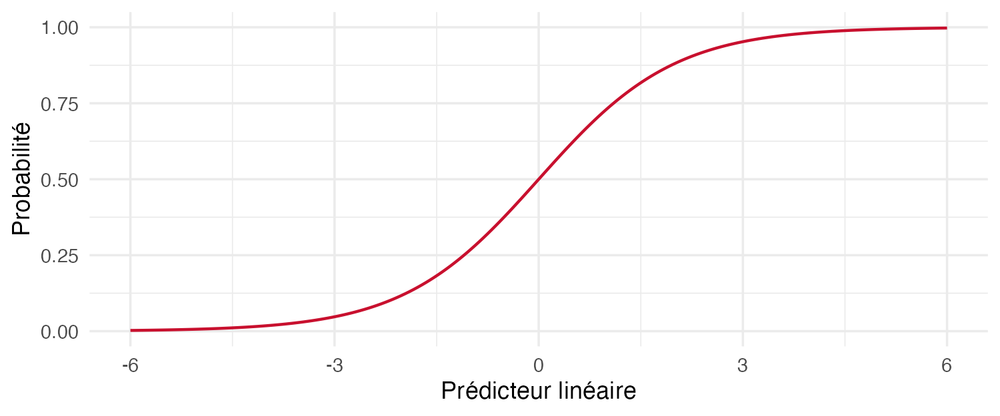

## Pourquoi ça compte

::: {.question-line}
Que dit une probabilité?
:::

::: {.note-box}
Deux profils peuvent avoir des risques différents. Le modèle décrit une association, pas l’effet d’un contact.
:::

## Objectifs de la capsule

::: {.keypoints}
- Ajuster une régression logistique sur l’apprentissage.
- Distinguer probabilité et cote.
- Interpréter un rapport de cotes sans conclusion causale.
:::

## Passer du modèle à une probabilité

::: {.keypoints}
- La régression logistique traduit un prédicteur linéaire en probabilité.
- Pour une probabilité $p$, la cote vaut $p/(1-p)$.
- À autres variables fixées, $\exp(\beta)$ multiplie les cotes pour une unité supplémentaire du prédicteur.
- Une probabilité n’est ni une certitude ni un effet causal.
:::

## Du risque à la cote, puis retour

Sur 100 clients comparables, un risque de 20 % correspond à 20 départs attendus.

| Quantité | Calcul | Valeur |
| --- | --- | --- |
| Cote initiale | 20 / 80 | 0,25 |
| Cote doublée | 2 × 0,25 | 0,50 |
| Nouvelle probabilité | 0,50 / (1 + 0,50) | 33,3 % |

::: {.note-box}
Doubler la cote fait passer le risque de 20 % à 33,3 % dans cet exemple.
:::

## Une courbe entre 0 et 1

{fig-alt="Courbe logistique : la probabilité augmente progressivement entre zéro et un" width="85%"}

## Lire la sortie de la régression

Le modèle a été ajusté sur les 389 clients d’apprentissage.

| Changement, toutes choses égales | Multiplicateur des cotes de départ |
| --- | --- |
| Un ticket de service supplémentaire | 1,443 |
| Un point de satisfaction supplémentaire | 0,541 |
| Contrat mensuel comparé au contrat annuel | 1,920 |

::: {.note-box}
Pour le contrat, nommez la catégorie de référence. Pour un ticket, nommez l’unité du changement.
:::

## Deux fiches pour un seul contraste

Même contrat mensuel, 24 mois d’ancienneté, utilisation 12, satisfaction 7 et aucun rabais.

| Profil | Tickets sur six mois | Risque estimé |
| --- | --- | --- |
| A | 1 | 32,0 % |
| B | 3 | 49,5 % |

::: {.note-box}
Le risque augmente d’environ 17,5 points de pourcentage entre les deux profils.
:::

## Pourquoi deux tickets changent-ils la cote ?

Un ticket supplémentaire multiplie la cote par 1,443. Deux tickets multiplient la cote deux fois.

| Calcul avec les valeurs arrondies | Résultat |
| --- | --- |
| Cote du profil A : 0,320 / 0,680 | 0,471 |
| Cote du profil B : 0,471 × 1,443² | 0,981 |
| Probabilité : 0,981 / 1,981 | Environ 49,5 % |

::: {.note-box}
Une même variation des cotes peut donner des écarts de probabilité différents selon le point de départ.
:::

## Que peut conclure le service à la clientèle ?

Une gestionnaire propose de fermer deux tickets pour diminuer le risque d’un client.

| Ce que les deux profils établissent | Ce qu’il faudrait pour évaluer l’action |
| --- | --- |
| Le modèle associe davantage de tickets à un risque plus élevé. | Observer comment évoluent des groupes comparables avec et sans intervention. |

::: {.note-box}
Un problème non résolu peut expliquer à la fois les tickets et le départ. Le contraste de profils ne mesure pas le bénéfice d’un appel.
:::

## À retenir

:::: {.metric-grid}
::: {.metric}
::: {.value}
Probabilité
:::
::: {.label}
risque compris entre 0 et 1, sans certitude individuelle
:::
:::
::: {.metric}
::: {.value}
Cotes
:::
::: {.label}
un rapport de cotes n’est pas un rapport de probabilités
:::
:::
::: {.metric}
::: {.value}
Référence
:::
::: {.label}
catégorie de comparaison et autres variables fixées
:::
:::
::::

## Production autonome 10.2

::: {.lead}
Ajustez une régression logistique sur l’apprentissage. Interprétez un rapport de cotes et deux probabilités prédites sans les présenter comme une certitude ou un effet causal.
:::

Cette production se réalise une seule fois dans le rapport guidé.

### Auto-vérification

::: {.self-check}
- Je distingue une cote d’une probabilité.
- Je nomme la référence et les variables maintenues fixes.
- Je ne prétends pas mesurer l’effet de l’intervention.
:::

## Références et crédits

Matériel MQT-2101, Université Laval. Données fictives simulées pour l’enseignement.

James, Witten, Hastie et Tibshirani (2021), *An Introduction to Statistical Learning*, 2e édition.
