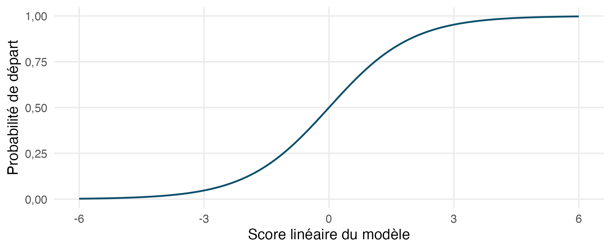

## Pourquoi ça compte

::: {.question-line}
Que dit une probabilité?
:::

::: {.note-box}
Deux profils peuvent avoir des risques différents. Le modèle décrit une association, pas l’effet d’un contact.
:::

## Objectifs de la capsule

::: {.keypoints}
- Ajuster une régression logistique sur l’apprentissage.
- Distinguer probabilité et cote.
- Interpréter un rapport de cotes sans conclusion causale.
:::

## Passer du modèle à une probabilité

::: {.keypoints}
- La régression logistique traduit un prédicteur linéaire en probabilité.
- Pour une probabilité $p$, la cote vaut $p/(1-p)$.
- À autres variables fixées, $\exp(\beta)$ multiplie les cotes pour une unité supplémentaire du prédicteur.
- Une probabilité n’est ni une certitude ni un effet causal.
:::

## Une courbe entre 0 et 1

{fig-alt="Courbe logistique : la probabilité augmente progressivement entre zéro et un" width="85%"}

## À retenir

:::: {.metric-grid}
::: {.metric}
::: {.value}
Probabilité
:::
::: {.label}
risque compris entre 0 et 1, sans certitude individuelle
:::
:::
::: {.metric}
::: {.value}
Cotes
:::
::: {.label}
un rapport de cotes n’est pas un rapport de probabilités
:::
:::
::: {.metric}
::: {.value}
Référence
:::
::: {.label}
catégorie de comparaison et autres variables fixées
:::
:::
::::

## Production autonome 10.2

::: {.lead}
Ajustez une régression logistique sur l’apprentissage. Interprétez un rapport de cotes et deux probabilités prédites sans les présenter comme une certitude ou un effet causal.
:::

Cette production se réalise une seule fois dans le rapport guidé.

### Auto-vérification

::: {.self-check}
- Je distingue une cote d’une probabilité.
- Je nomme la référence et les variables maintenues fixes.
- Je ne prétends pas mesurer l’effet de l’intervention.
:::

## Références et crédits

Matériel MQT-2101, Université Laval. Données fictives simulées pour l’enseignement.

James, Witten, Hastie et Tibshirani (2021), *An Introduction to Statistical Learning*, 2e édition.
