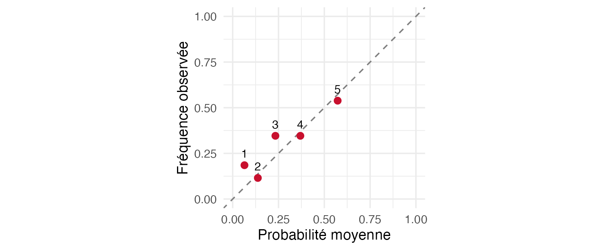

## Pourquoi ça compte

::: {.question-line}
Le modèle suffit-il pour agir?
:::

::: {.note-box}
Une performance sur un test fictif ne suffit pas à garantir l’efficacité d’une intervention réelle.
:::

## Objectifs de la capsule

::: {.keypoints}
- Évaluer la règle déjà choisie sur le test.
- Décrire l’accord entre probabilités et fréquences observées.
- Formuler une recommandation avec ses limites.
:::

## Évaluer une règle déjà choisie

::: {.keypoints}
- Appliquer au test la règle retenue en validation.
- Comparer probabilités moyennes et fréquences observées par groupes.
- La règle alternative préétablie cible au plus 15 % des clients, selon leur risque prédit.
:::

## Appliquer le seuil une seule fois

Sur les 131 clients du test, la règle de seuil reste fixée à 0,30.

| Décision | Départ | Aucun départ | Total |
| --- | --- | --- | --- |
| Ciblé | 22 | 28 | 50 |
| Non ciblé | 18 | 63 | 81 |
| Total | 40 | 91 | 131 |

::: {.note-box}
22 / 40 = 55 % des départs détectés. Parmi les 50 contacts, 22 / 50 = 44 % sont des départs observés.
:::

## Comparer avec une règle très simple

La classe majoritaire de l’apprentissage est « aucun départ ».

| Politique sur le test | Départs détectés | Exactitude | Coût fictif |
| --- | --- | --- | --- |
| Toujours prédire 0 | 0 sur 40 | 91 / 131 | 160 |
| Seuil 0,30 | 22 sur 40 | 85 / 131 | 100 |

::: {.note-box}
La règle majoritaire a une meilleure exactitude, mais manque les 40 départs. Quelle mesure répond au mandat ?
:::

## Comparer probabilités et fréquences sur le test

{fig-alt="Fréquence de départ observée et probabilité moyenne dans cinq groupes de risque sur le test" width="85%"}

Un groupe proche de la diagonale ne prouve pas une calibration parfaite.

## Lire un point de calibration

Les clients du test sont ordonnés par risque et répartis en cinq groupes d’effectifs proches.

| Groupe | Clients | Risque moyen | Fréquence observée |
| --- | --- | --- | --- |
| Risques les plus faibles | 27 | 6,4 % | 5 / 27 = 18,5 % |
| Risques les plus élevés | 26 | 57,3 % | 14 / 26 = 53,8 % |

::: {.note-box}
Dans le premier groupe, la fréquence dépasse la prévision moyenne. Avec 27 clients, on ne peut pas présumer que cet écart se reproduira.
:::

## Tenir la promesse de 15 %

Quinze pour cent de 131 vaut 19,65. Vingt contacts dépasseraient le plafond.

| Politique annoncée | Contacts | Départs détectés | Précision |
| --- | --- | --- | --- |
| Seuil 0,30 | 50 | 22 sur 40 | 44,0 % |
| 19 risques les plus élevés | 19 | 12 sur 40 | 63,2 % |

::: {.note-box}
La liste courte concentre davantage les départs, mais elle en laisse 28 hors de la liste.
:::

## Que transmettre à la direction ?

Vous avez une liste de 19 noms, une capacité limitée et aucun résultat d’intervention.

| À chiffrer | À vérifier avant d’étendre l’action |
| --- | --- |
| Sur ce test, 12 des 19 clients les mieux classés sont partis. | Le risque se maintient-il sur la prochaine cohorte ? |
| Le modèle classe des risques individuels. | Un contact réduit-il effectivement les départs ? |

::: {.note-box}
Suivre les départs futurs et évaluer séparément l’effet du contact permet de répondre aux deux questions.
:::

## À retenir

:::: {.metric-grid}
::: {.metric}
::: {.value}
Évaluation
:::
::: {.label}
appliquer la règle fixée sur des clients du test
:::
:::
::: {.metric}
::: {.value}
Calibration
:::
::: {.label}
décrire l’accord entre probabilités et fréquences
:::
:::
::: {.metric}
::: {.value}
Action
:::
::: {.label}
un risque prédit ne mesure pas l’effet du contact
:::
:::
::::

## Production autonome 10.5

::: {.lead}
Appliquez au test le seuil retenu, décrivez la calibration par groupes et examinez la règle alternative préétablie des 15 % de risques les plus élevés. Formulez une recommandation avec deux limites.
:::

Cette production se réalise une seule fois dans le rapport guidé.

### Auto-vérification

::: {.self-check}
- Je sépare choix en validation et évaluation en test.
- Je décris la calibration sans la prouver.
- Je distingue risque de départ et effet d’un contact.
:::

## Références et crédits

Matériel MQT-2101, Université Laval. Données fictives simulées pour l’enseignement.

James, Witten, Hastie et Tibshirani (2021), *An Introduction to Statistical Learning*, 2e édition.
