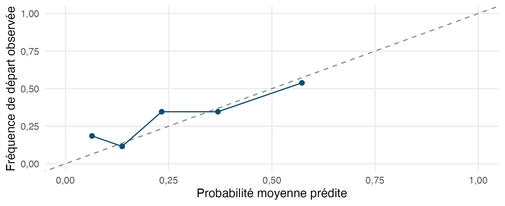

## Pourquoi ça compte

::: {.question-line}
Le modèle suffit-il pour agir?
:::

::: {.note-box}
Une performance sur un test fictif ne suffit pas à garantir l’efficacité d’une intervention réelle.
:::

## Objectifs de la capsule

::: {.keypoints}
- Évaluer la règle déjà choisie sur le test.
- Décrire l’accord entre probabilités et fréquences observées.
- Formuler une recommandation avec ses limites.
:::

## Évaluer une règle déjà choisie

::: {.keypoints}
- Appliquer au test la règle retenue en validation.
- Comparer probabilités moyennes et fréquences observées par groupes.
- La règle alternative préétablie cible au plus 15 % des clients, selon leur risque prédit.
:::

## Comparer probabilités et fréquences sur le test

{fig-alt="Fréquence de départ observée et probabilité moyenne dans cinq groupes de risque sur le test" width="85%"}

Un groupe proche de la diagonale ne prouve pas une calibration parfaite.

## À retenir

:::: {.metric-grid}
::: {.metric}
::: {.value}
Évaluation
:::
::: {.label}
appliquer la règle fixée sur des clients du test
:::
:::
::: {.metric}
::: {.value}
Calibration
:::
::: {.label}
décrire l’accord entre probabilités et fréquences
:::
:::
::: {.metric}
::: {.value}
Action
:::
::: {.label}
un risque prédit ne mesure pas l’effet du contact
:::
:::
::::

## Production autonome 10.5

::: {.lead}
Appliquez au test le seuil retenu, décrivez la calibration par groupes et examinez la règle alternative préétablie des 15 % de risques les plus élevés. Formulez une recommandation avec deux limites.
:::

Cette production se réalise une seule fois dans le rapport guidé.

### Auto-vérification

::: {.self-check}
- Je sépare choix en validation et évaluation en test.
- Je décris la calibration sans la prouver.
- Je distingue risque de départ et effet d’un contact.
:::

## Références et crédits

Matériel MQT-2101, Université Laval. Données fictives simulées pour l’enseignement.

James, Witten, Hastie et Tibshirani (2021), *An Introduction to Statistical Learning*, 2e édition.
